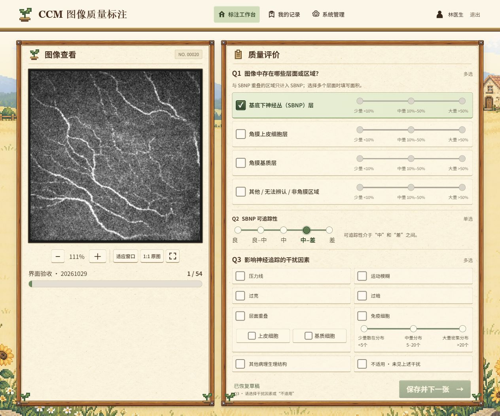

# CCM 图像质量标注

根据《CCM 图像质量标注操作手册 20261029》最新修订实现的自托管 Web 标注应用，规则版本为 `20261029-r4`。每位标注员独立标注全部图像，首次领取任务时生成并保存各自的随机顺序，重新登录后继续未完成的图像。

界面先使用内置 imagegen 生成参考稿，再对照实现：生成的木纹边框与四角铆钉、细纹理纸面、田园像素背景、带图标的导航和分档滑杆。内置 Noto Sans SC 中文字体，让不同设备显示一致。医学图像保持原始灰度与亮度。



## 已实现

- 管理员指定服务器图像目录，递归扫描、校验并导入；启用不同图像集。
- 管理员创建标注员、停用/启用账号、重置密码、查看累计提交量。
- 独立随机任务顺序、服务器草稿自动保存、刷新恢复、提交后自动下一张。
- 左侧原图缩放/平移/全屏；右侧 Q1 四行层面选项、Q2 五档滑杆、Q3 双列干扰因素。Q3 子选项常驻同一选项卡内部：层面重叠为两个多选控件，免疫细胞为三档滑杆，不再展开额外区域。直接操作子选项会自动选中对应干扰因素。
- **Q1 只有 a（SBNP）时 Q2/Q3 可用**；包含 b/c/d 时跳过两题，保存 `q2="n"`、`q3=null`。切回纯 SBNP 后必须重新填写。SBNP 与相邻层面重叠的区域在 Q1 中只计为 SBNP，重叠类型在 Q3 中记录。
- Q1 仅多选时要求每个层面的面积；单选面积存为 `null`，不会自动推定为“大量”。Q2 评价 SBNP 可追踪性，分为良／良–中／中／中–差／差，其中两档为相邻等级的中间选项。Q3 的 `n` 与其他干扰互斥；层面重叠可同时选择上皮和基质，免疫细胞数量必须在 `<5`、`5–20`、`>20` 中单选，其中中量包含 5 个和 20 个。
- 最近 100 条正式记录可回看修改；修改前后的正式版本均保留。
- 管理员导出 CSV、JSONL 与修改历史；包含文件相对路径、SHA-256、出示顺序、手册版本、时间。
- 不提供操作手册浏览功能；没有手册弹窗、手册 API 或示例图接口。
- 服务端权限与规则校验、密码哈希、HttpOnly Cookie、CSRF 校验、登录限速、并发版本冲突保护。

## 技术与目录

Python 3.11+、FastAPI、SQLite WAL、原生 HTML/CSS/JavaScript。前端无构建步骤，无 CDN 或外部字体依赖。默认单进程服务，适合一个研究团队的标注任务。

```text
annotation-web/
├── app/                       后端、规则、账号管理、备份命令
├── static/                    页面、交互、样式、生成的田园背景
├── design/                    生图参考、提示词、实际页面截图
├── tests/                     自动化接口与规则测试
├── deploy/Caddyfile           可选 HTTPS 反向代理
├── compose.yaml / Dockerfile  服务器部署
├── .env.example               部署变量模板
└── .github/workflows/tests.yml GitHub 自动测试
```

`data/`、`output/`、`.env`、缓存和数据库均已加入 `.gitignore`。正式待标注图像使用服务器外部目录，不需要提交到仓库。设计稿中的医学图为合成占位图，程序不会用它作为标注图像。

## 服务器部署：Docker Compose

### 1. 准备文件

将这个文件夹作为 GitHub 仓库根目录。服务器安装 Docker Engine 与 Docker Compose 后克隆仓库，并进入该目录：

```bash
cp .env.example .env
```

修改 `.env`，例如：

```dotenv
IMAGE_FOLDER=/srv/ccm/images
CCM_DOMAIN=ccm.example.org
CCM_PUBLIC_ORIGIN=https://ccm.example.org
CCM_SECURE_COOKIE=1
CCM_PORT=8000
```

将图像放在 `/srv/ccm/images/batch-01/` 等子目录。此目录会以只读方式挂载到容器的 `/images`。容器用户 UID/GID 为 `10001`，须对图像文件具有读权限、对目录具有遍历权限。

### 2. 启动

已有 HTTPS 反向代理时：

```bash
docker compose up -d --build web
```

将自己的反向代理指向 `127.0.0.1:8000`，保留 `Host` 头；将公开网址完整填写为 `CCM_PUBLIC_ORIGIN`，不要带末尾斜杠。

需要本项目的 Caddy 自动管理 HTTPS 时：先把域名 A/AAAA 记录指向服务器，开放 80/443 端口，再运行：

```bash
docker compose --profile https up -d --build
```

默认 Web 端口仅监听服务器本机，外部用户通过 HTTPS 入口访问。

### 3. 创建管理员

```bash
docker compose exec web python -m app.manage create-admin admin
```

按提示输入密码两次（10–128 个字符，输入不回显）。**项目没有内置管理员或默认密码。**

### 4. 在网页完成初始化

1. 访问自己的 HTTPS 域名，使用管理员账号登录。
2. 点击「系统管理」，填写图像集名称与目录，例如 `/images/batch-01` 或相对目录 `batch-01`。
3. 点击「扫描并导入」，查看跳过文件的原因，再点击「启用」。
4. 创建标注员账号，将账号信息交给相应标注员。
5. 标注员登录「标注工作台」开始标注。每个账号都拥有全部图像的独立随机队列。

容器中应填写 `/images` 下的路径，**不是宿主机 `/srv/ccm/images` 的路径**。导入是一次固定清单，不会自动追加以后新放入的文件；新增批次请放入新的子目录并创建新图像集。同一目录不能重复导入，分配方式不能在导入后修改。

### 5. 检查与维护

```bash
docker compose ps
docker compose logs --tail 100 web
curl http://127.0.0.1:8000/api/health
```

SQLite 数据保存在 `ccm_data` Docker 命名卷中，重启/重建容器不会清空。不要使用 `docker compose down -v`，它会删除数据卷。

## 交给服务器上的 Codex 部署

本仓库现为公开仓库，服务器可以直接通过 HTTPS 克隆，无需 GitHub 登录：

```bash
git clone https://github.com/SummerColdWind/ccm-annotation-web.git
cd ccm-annotation-web
```

可以把下面的说明发送给服务器上的 Codex，并补充实际域名与服务器图像目录：

```text
请克隆并部署 https://github.com/SummerColdWind/ccm-annotation-web ，先阅读 README.md、compose.yaml 和 Dockerfile。
系统是 Ubuntu 24.04，已有 Nginx／宝塔占用 80/443。
请检查现有 Docker、Compose、反向代理和端口，保留现有网站配置与数据。
使用 Docker Compose 只启动 web 服务，不启用 https profile 或 Caddy。
应用默认绑定宿主机 127.0.0.1:8000；如端口被占用，选择空闲端口并同步配置代理。
请先向我确认正式访问域名和服务器图像目录，随后配置 .env。
通过现有 Nginx／宝塔建立这个域名的 HTTPS 反向代理，保留 Host，关闭代理缓存。
CCM_PUBLIC_ORIGIN 必须与正式 HTTPS 网址完全一致，CCM_SECURE_COOKIE=1。
图像目录只读挂载到 /images，并确保 UID 10001 可读取文件和遍历目录。
通过 app.manage 创建正式管理员，密码由我在服务器终端交互输入，不要使用演示账号。
最后验证健康检查、HTTPS、管理员登录、图像导入、草稿保存和提交，并说明备份命令。
不要删除 Docker 数据卷，不要提交 .env、数据库、正式图像或凭据。
```

如果现有 Nginx 也运行在容器内，需按其网络连接方式配置代理；Nginx 容器内的 `127.0.0.1` 不代表宿主机。

## 本地运行（不使用 Docker）

在项目根目录执行；Windows 推荐已有的 `pytorch` Conda 环境：

```powershell
conda run -n pytorch python -m pip install -r requirements.txt
$env:CCM_IMAGE_ROOT = 'D:\your-images'
$env:CCM_SECURE_COOKIE = '0'
$env:CCM_PUBLIC_ORIGIN = 'http://127.0.0.1:8000'
conda run -n pytorch python -m app.manage create-admin admin
conda run --no-capture-output -n pytorch python -m uvicorn app.main:app --host 127.0.0.1 --port 8000
```

Linux/macOS：

```bash
python -m venv .venv
. .venv/bin/activate
pip install -r requirements.txt
export CCM_IMAGE_ROOT=/absolute/path/to/images
export CCM_SECURE_COOKIE=0
export CCM_PUBLIC_ORIGIN=http://127.0.0.1:8000
python -m app.manage create-admin admin
python -m uvicorn app.main:app --host 127.0.0.1 --port 8000
```

本机浏览器打开 `http://127.0.0.1:8000`。未设置 `CCM_IMAGE_ROOT` 时使用 `data/images`；未设置 `CCM_DB` 时数据库为 `data/ccm.sqlite3`。Python 直接运行不会自动读取 `.env`；`.env` 用于 Docker Compose。

快速试用时请准备自己的测试图片目录，设置 `CCM_IMAGE_ROOT` 后在管理端导入。项目不再携带手册示例图。

## 数据与规则

| 字段 | 含义 |
| --- | --- |
| `q1_layers` | 已选择的层面代码，以分号分隔：a SBNP、b 上皮、c 基质、d 其他区域 |
| `q1_a` / `q1_b` / `q1_c` / `q1_d` | 多选层面的面积代码；单选和未选择均为空，是否选择以 `q1_layers` 为准 |
| `i / j / k` | 少量 `<10%` / 中量 `10%–50%` / 大量 `>50%` |
| `q2` | SBNP 可追踪性：a 良、ab 良–中、b 中、bc 中–差、c 差、n 跳过；顺序为 a → ab → b → bc → c |
| `q3` | a 压力线、b 运动模糊、c 过亮、d 过暗、e 层面重叠、f 免疫细胞、g 其他病理生理结构、n 未见上述干扰；多选以分号分隔，跳过为空 |
| `q3_overlap` | e1 上皮细胞、e2 基质细胞；允许 `e1;e2` |
| `q3_immune` | f1 少量散在分布 `<5个`、f2 中量分布 `5–20个`（含端点）、f3 大量密集分布 `>20个` |
| `presentation_order` | 本账号首次分配时的出示顺序编号 |
| `sha256` | 导入时的图像文件哈希 |
| `manual_version` | 标注规则版本，本版为 `20261029-r4`，不是手册浏览功能 |

接口保存结构示例（纯 SBNP、两类细胞重叠和大量免疫细胞）：

```json
{"q1":{"a":null},"q2":"b","q3":["e","f"],"q3_details":{"e":["e1","e2"],"f":"f3"}}
```

草稿与提交请求另需携带当前 `revision` 和 `manual_version: "20261029-r4"`。非纯 SBNP 图像保存 `q3=null`；这与纯 SBNP 下选择 `q3=["n"]`（已评价且未见干扰）含义不同。

所有导出时间均为 UTC。CSV 带 UTF-8 BOM，便于 Excel 打开。普通导出只包含最新正式提交，不包含草稿；「修改记录」导出全部正式版本。跨图像集时 `presentation_order` 可继续递增。

图像仅支持单帧 PNG/JPEG/BMP/TIFF/WebP；只导入可直接显示的 `L/RGB/RGBA/P/1` 模式。高位深、CMYK、多帧文件会明确跳过，不会擅自做灰度归一化。PNG/JPEG/WebP 按原文件响应；BMP/TIFF 按原像素无损转 PNG 供浏览器查看。**不支持窗宽窗位、增强、对比度或亮度调整。** 文件内容改变或移出允许目录后会阻止显示/保存，请建立新目录与新图像集。

## 从旧版升级

本次同日修订以 `20261029-r4` 区分：Q2 在原有良／中／差之间增加“良–中”和“中–差”，代码分别为 `ab`、`bc`，原有 `a/b/c` 的含义不变；“中”的说明补充关注图像边缘及角落区域。Q3 仍为三档免疫细胞数量。账号、图像集与任务随机顺序保留；旧草稿不会作为新版答案恢复，页面提示重新填写当前图像。旧页面提交会被版本检查拒绝，需刷新浏览器。从四题版升级时，数据库会自动添加草稿版本字段，无需删除数据卷。

旧提交和修改历史会保留，并可导出；不允许用新版规则编辑，也不会把旧答案自动重算为新版答案。分析导出数据时必须按 `manual_version` 区分：`20261029` 的 Q2 为优／良／差、免疫细胞为 `<10` / `≥10`；`20261029-r2` 的 Q2 为良／中／差、免疫细胞为 `<20` / `≥20`；`20261029-r3` 的 Q2 不变、免疫细胞为 `<5` / `5–20` / `>20`。三题版的 `q3_overlap` 与 `q3_immune` 均保留，旧 f2 不会自动映射成新版中量或大量。更早的 `20261027` 四题版导出可能包含旧 `q4` 列。

在服务器项目目录中，先按下方“备份与恢复”完成备份，再执行：

```bash
git pull --ff-only
docker compose up -d --build web
curl http://127.0.0.1:8000/api/health
```

健康检查应显示 `manual_version` 为 `20261029-r4`；如已设置其他 `CCM_PORT`，同步修改检查端口。

## 备份与恢复

运行一致性备份（会包含 SQLite WAL 中已提交的数据）：

```bash
docker compose exec web python -m app.backup /data/backups/ccm-20261028.sqlite3
docker compose cp web:/data/backups/ccm-20261028.sqlite3 ./ccm-20261028.sqlite3
```

备份文件包含账号哈希与标注数据，不要提交到 GitHub。正式图像目录需单独备份，并保留原目录结构和文件内容。

恢复时先停止 Web 容器，保留当前数据卷以便回退，然后使用新的数据卷放入备份文件并保持 `/data/ccm.sqlite3` 路径及 UID `10001` 的读写权限；同样挂载原图像目录到 `/images` 后再启动。不要把一个运行中的 `.sqlite3` 文件单独复制作为备份，也不要覆盖运行中的数据库。

忘记密码可在服务器执行：

```bash
docker compose exec web python -m app.manage reset-password admin
```

## 验证

```bash
pip install -r requirements-dev.txt
python -m pytest -q
node --check static/app.js
node --test tests/test_form.cjs
```

后端测试覆盖标注规则、独立随机队列、权限、CSRF、源文件变更、草稿恢复、并发冲突、修改历史、导出与账号管理。验证环境与浏览器检查详见 [验收记录](design/VALIDATION.md)。

如果既有 Conda 环境自动加载了无关 pytest 插件，可仅在测试进程设置 `PYTEST_DISABLE_PLUGIN_AUTOLOAD=1`；不需要改动全局环境。

## GitHub 整理

以本文件夹为仓库根目录提交即可，CI 文件已放在正确位置。旧手册及示例图已从当前源码移除，应用不依赖父目录中的任何文件。

也可运行 `python tools/package_release.py`，生成 `dist/ccm-annotation-web.zip`。该压缩包仅包含源码、部署文档与设计资源，不包含 `.env`、数据库、临时测试账号或缓存。

设计参考、田园背景、木框和纸张材质由内置 imagegen 生成，提示词保存在 [design/PROMPTS.md](design/PROMPTS.md)。字体采用 SIL OFL 1.1 许可证，详见 [字体来源](static/fonts/README.md)。没有使用游戏原版素材。正式图像、账号数据库、真实密码和部署 `.env` 均不在源码交付清单中。
