# CCM 图像质量标注操作手册 20261027版

## 0. 准备

打开图片，放大到合适大小，足够看清细节，保持灰度和亮度不变。

质量标注包括四个步骤，均为选择题。

## 1. Q1 - 图像中可辨认出哪些角膜层面或区域？（多选）

鉴于角膜的不同层面，以及非角膜区域，可同时存在于同一图像中，此步骤旨在确定图像中包含哪些层面。感兴趣的层面为基底下神经丛（SBNP）层，角膜上皮细胞层和角膜基质层与其相邻，其他层或非角膜区域均归为一类。

a. 基底下神经丛（SBNP）层 
可见高反光、细长的神经纤维，呈线状或串珠状，常有弯曲、分叉及纤维间连接，背景相对均匀。

Q1a 示例：

**R0200：** 下半部可见斜行、串珠状神经纤维及分叉。

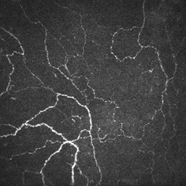

**R0961：** 细长神经弯曲、分叉，呈网状分布。

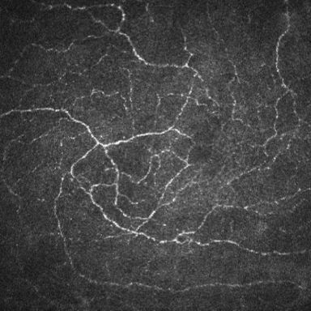

**R1605：** 中央及下半部可见弧形神经纤维和细小分支。

b. 角膜上皮细胞层  
可见密集排列的多边形细胞，常呈网格状或铺路石样。

Q1b 示例：

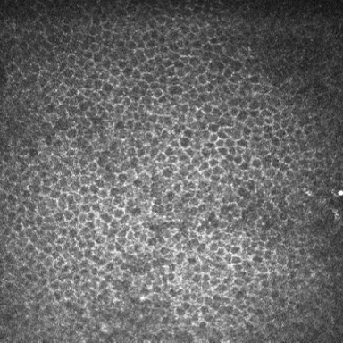

**R1086：** 密集多边形细胞排列成网格，边界亮、内部暗。

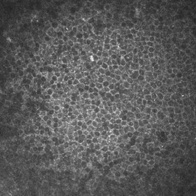

**R2463：** 中央多边形细胞紧密排列，呈蜂窝样网格。

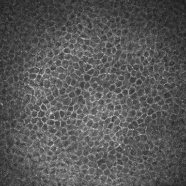

**R2470：** 多边形细胞紧密铺排，中央至左下方边界清楚。

c. 角膜基质层  
可见散在的高反光细胞核，呈点状、长圆形或梭形，分布通常较上皮细胞疏，部分区域可见较粗的基质神经。

Q1c 示例：

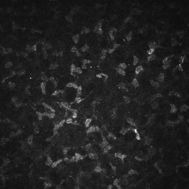

**R0372：** 散在椭圆形、短梭形高反光结构，呈基质细胞核样外观。

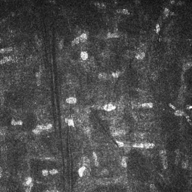

**R1098：** 椭圆形或短条状亮核散在分布，间隔较大。

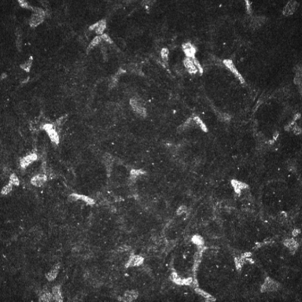

**R2535：** 散见梭形及不规则高反光细胞核样结构。

d. 其他角膜层面 /  无法辨认的区域 / 非角膜区域
包括可辨认但不属于前三类的其他角膜层面，如弹力层或内皮层，也包括因信息不足而无法确定层面，以及可确认不属于角膜组织的区域。

Q1d 示例：

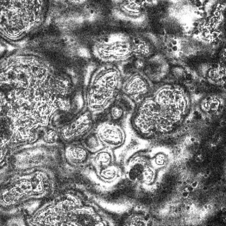

**R0494：** 环形纹理遍布视野，正常组织层面难以辨认。

**R1231：** 弧形界面及孔洞样纹理明显，缺乏可辨认的角膜层面特征。

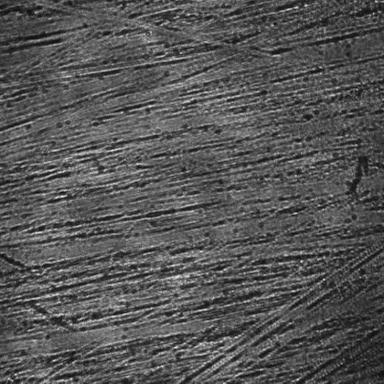

**R1239：** 密集平行条纹覆盖全图，无法辨认具体角膜层面。

对于每个被选择的类别，进一步记录其在整幅图像中的大致面积：

i. 少量：<10%
j. 中量：10%–50%
k. 大量：>50%

多层面混合示例：

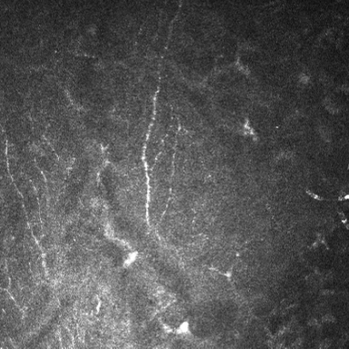

**R0366：** 左侧见细神经，右侧及下方见基质细胞核样结构。

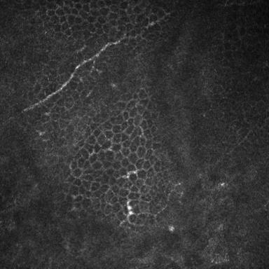

**R2283：** 多边形上皮细胞网格与上部斜行神经同时可见。

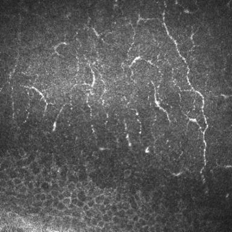

**R2402：** 上方及右侧见神经，左下方见上皮细胞网格。

## 2. Q2 - 图像中SBNP的整体可判读性如何？（有序分级单选）

此步骤只关注图像中基底下神经丛（SBNP）层的部分区域，评价的是可见神经能否被可靠识别和追踪，与神经数量、密度或疾病严重程度无关。
若存在除基底下神经丛（SBNP）层以外的层面或区域，则直接选择`n. 不适用`选项。

a. 优 
可见神经边界及细节清楚，与背景分离良好；中心线及可见分支的连接关系明确，能可靠完成神经追踪。

Q2a 示例：

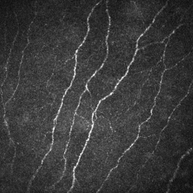

**R1599：** 神经边界及串珠样细节清楚，可连续追踪。

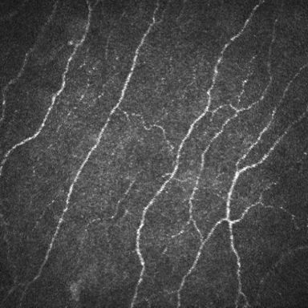

**R1600：** 细小分支与主干衔接清楚，连接关系明确。

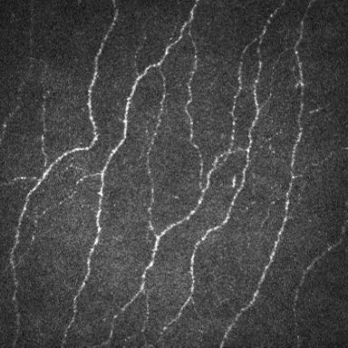

**R1602：** 长纤维及斜行分支清晰，中心线可连续追踪。

b. 良
存在轻度模糊、低对比或局部细节损失，但绝大多数可见神经的中心线及连接关系仍能可靠判断。

Q2b 示例：

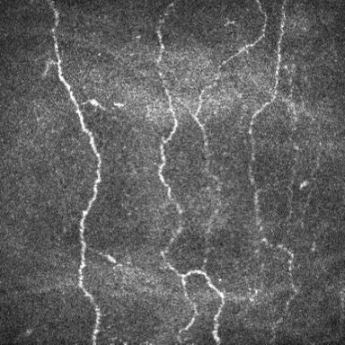

**R0116：** 中央及右侧神经稍淡，多数路径和分叉仍明确。

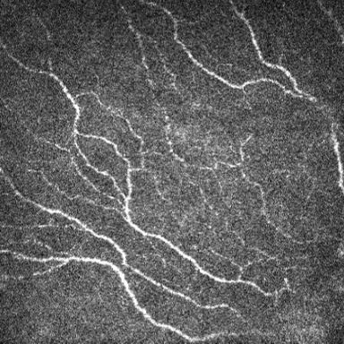

**R0237：** 中央细支对比度略低，多数神经连接仍可辨认。

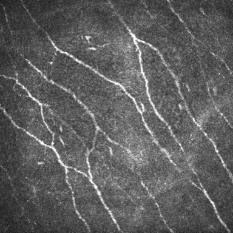

**R0576：** 部分细支稍模糊，多数神经路径仍明确。

c. 中
神经总体可见，但部分神经节段、边界或连接关系存在明显不确定性，部分位置需要推测才能完成追踪。

Q2c 示例：

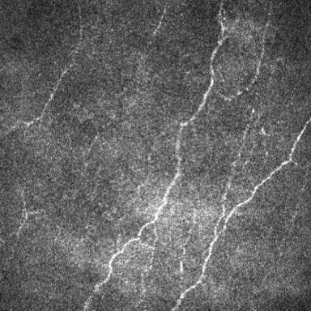

**R0061：** 左侧和中央细纤维较淡，部分连接需推测。

**R0080：** 主干尚清楚，部分淡弱细支的延续方向不确定。

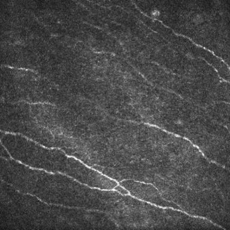

**R0200：** 下方主干尚清楚，中央及上方细纤维难以完整追踪。

d. 差
多处或主要神经路径无法可靠判断，难以完成可信的整图神经追踪。

Q2d 示例：

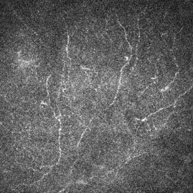

**R0121：** 多条神经淡弱、断续，多处连接关系无法确定。

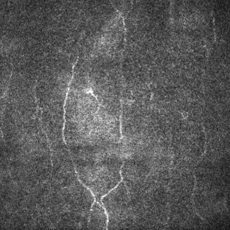

**R0124：** 多条神经在模糊处难以辨认，无法可靠连续追踪。

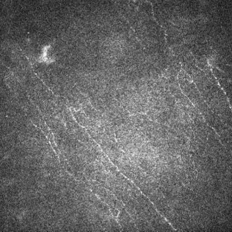

**R0126：** 多数神经仅见淡弱轮廓，连接关系难以可靠判断。

n. 不适用 
图像存在除SBNP以外的层面或区域。

## 3. Q3 - 图像中是否存在与SBNP产生视觉混淆的生理或病理结构？（有序分级单选）

包括但不限于树突状细胞、炎症相关结构、沉积物或其他异常结构。这些结构可能与神经相邻或重叠，与SBNP产生混淆，影响追踪的准确性。此步骤关注的仍是评价的是可见神经能否被可靠识别和追踪。
若存在除基底下神经丛（SBNP）层以外的层面或区域，则直接选择`n. 不适用`选项。

a. 不存在
图像中不存在上述除SBNP之外的生理或病理结构。

Q3a 示例：

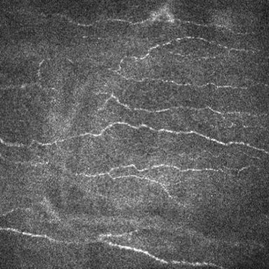

**R0080：** 未见明确的非神经细胞样团块或突起。

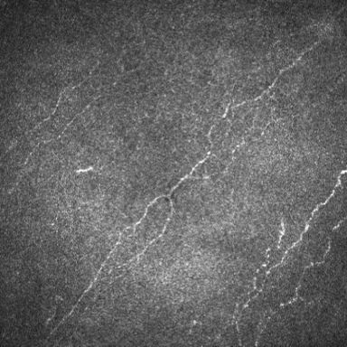

**R0247：** 仅见少量孤立亮点，未见明确的细胞样轮廓。

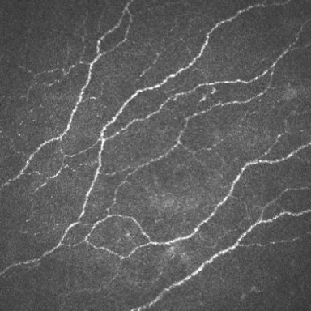

**R2600：** 神经间背景较均匀，未见明确的非神经细胞样结构。

b. 存在且分离良好 
存在上述结构，但其形态及空间位置与SBNP神经容易区分，不存在重叠或接触。

Q3b 示例：

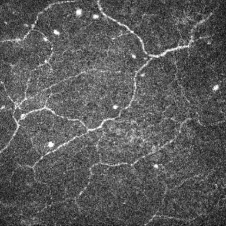

**R0149：** 散在圆形亮点与长神经分离，形态易区分。

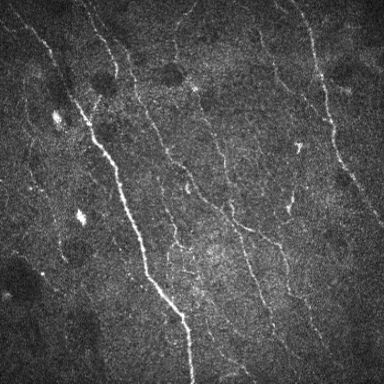

**R0188：** 椭圆形亮斑及短突起与邻近神经分开。

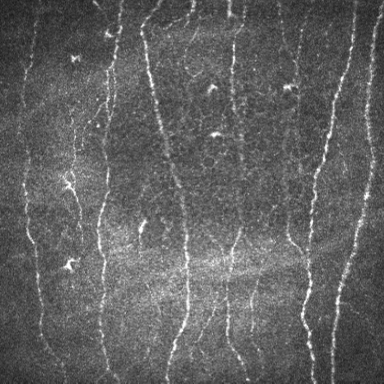

**R0626：** 零散梭形、星芒状亮结构与神经分离。

c. 存在局部混淆
部分结构与SBNP神经发生接触、重叠或形态相似，使得少量（<=3处）神经追踪难以确定。

Q3c 示例：

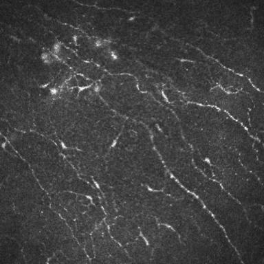

**R2220：** 左上方细胞样突起与神经局部交织，连接难辨。

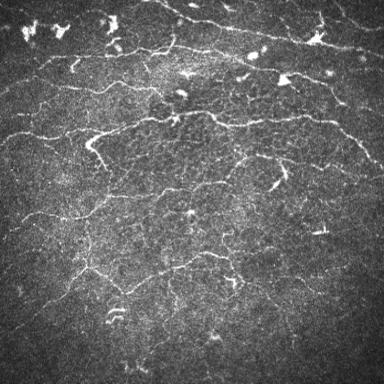

**R2401：** 上方少数细胞样结构与神经相接，局部连接不清。

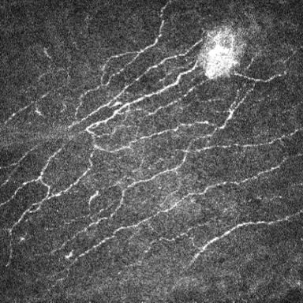

**S0139：** 右上方亮团遮掩邻近神经，局部延续关系不清。

d. 存在广泛混淆  
上述结构广泛分布，并与神经大量重叠或混杂，使得多处（>3处）神经追踪难以辨认。

Q3d 示例：

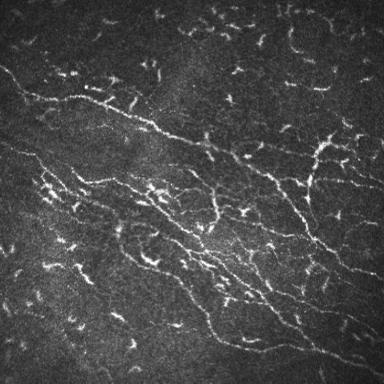

**R1424：** 大量短突起与神经交织，多处分支归属难辨。

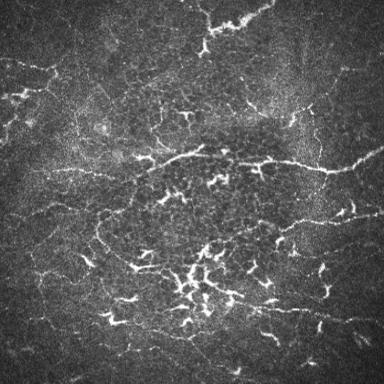

**R1478：** 成群星芒状结构与神经混杂，多处路径难辨。

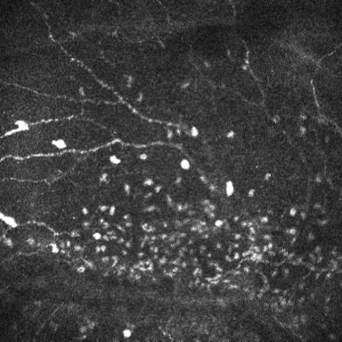

**S0130：** 中下部密集亮颗粒与神经混杂，多处路径难辨。

n. 不适用 
图像存在除SBNP以外的层面或区域。

## 4. Q4 - 图像中是否存在采集相关退化或伪影？（多选）

a. 压力相关条纹、嵴状结构或压痕  
较宽的带状、折皱样或嵴状结构，可呈平行、弯曲或交错走向，局部组织可能同时呈受压或变形外观。

Q4a 示例：

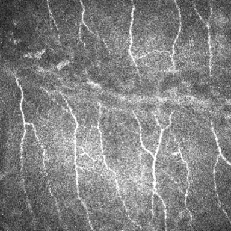

**R0347：** 宽阔弯曲条带横跨神经，呈折皱、压痕样外观。

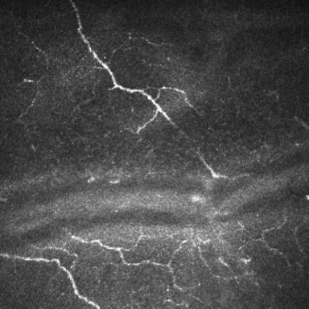

**R0434：** 中下部宽亮带与暗带交替，呈横向波浪状。

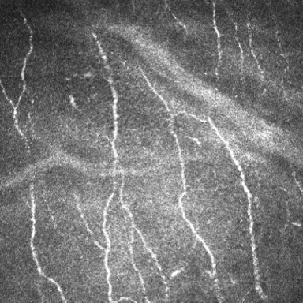

**R0603：** 斜行宽亮带及弧形条带呈嵴状外观。

b. 运动模糊（含眼动造成的锯齿、拉伸、逐行错位等畸变）  
拖影、模糊，或连续结构发生锯齿样变形、拉伸和逐行错位等异常。

Q4b 示例：

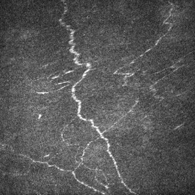

**R0069：** 中央神经出现锯齿样、阶梯样横向错位。

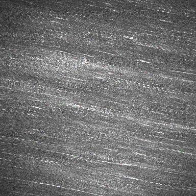

**R1553：** 全图亮点被同向拉成长线，拖影明显。

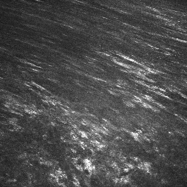

**R1563：** 亮结构沿斜向拉长，形成成束拖尾。

c. 局部过亮 / 过曝  
局部成片泛白，神经、细胞的边界及内部细节被高亮区域淹没。

Q4c 示例：

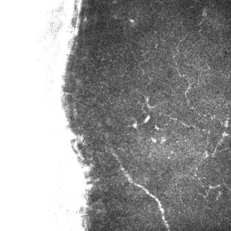

**R0252：** 左侧大面积泛白，区内组织细节消失。

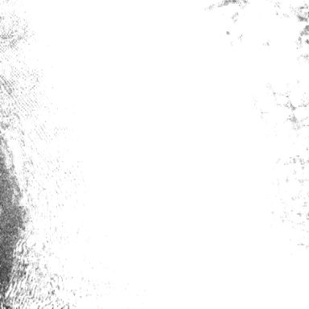

**R0501：** 几乎全图泛白，神经和细胞细节被淹没。

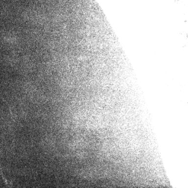

**R1295：** 右侧大片泛白，细结构在高亮区内消失。

d. 局部过暗 / 曝光不足  
局部明显变暗，神经或细胞与背景的灰度差减小，细纤维、边界等细节难以辨认。

Q4d 示例：

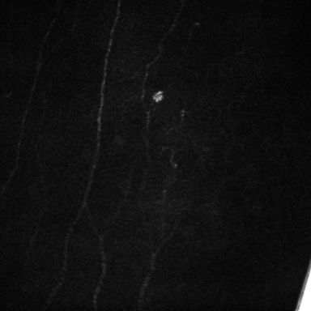

**R1322：** 全图接近黑色，神经与背景对比度极低。

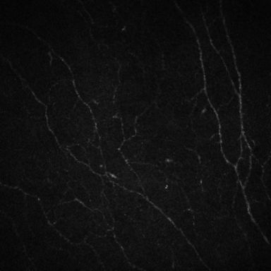

**R1324：** 整体偏暗，细弱神经节段融入背景。

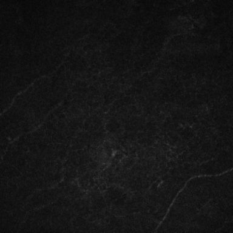

**R1337：** 大部分区域过暗，神经细节难以辨认。

e. 其他采集伪影  
出现上述类别以外的非解剖性图案特征。

Q4e 示例：

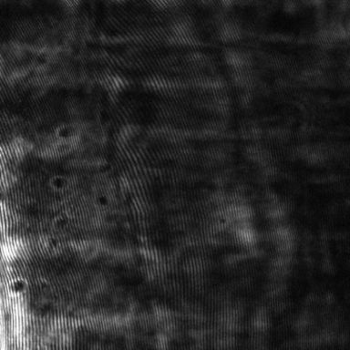

**R1063：** 密集、规则的周期性细条纹覆盖组织背景。

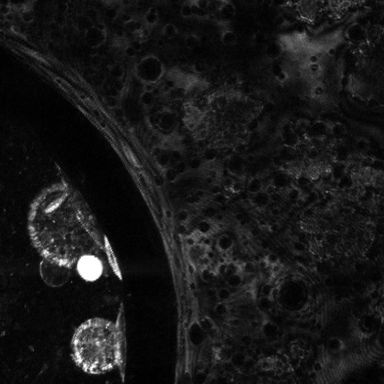

**R1231：** 粗大弧形界面及环孔样纹理占据大部分视野。

**R1237：** 明显同心环纹伴密集小暗点，呈干涉样外观。

n. 不适用 
未见上述明显退化或伪影

